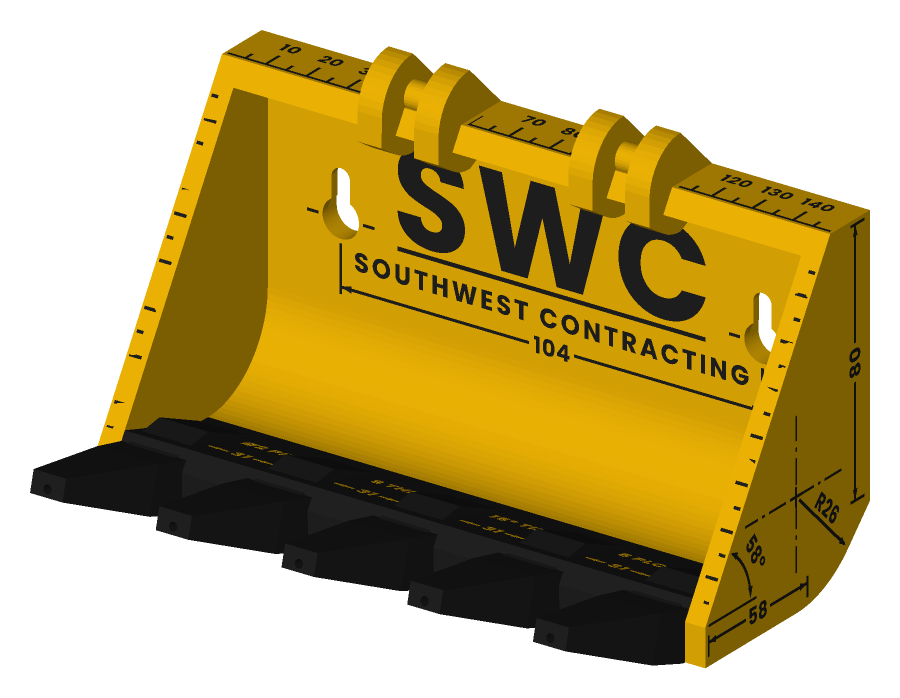
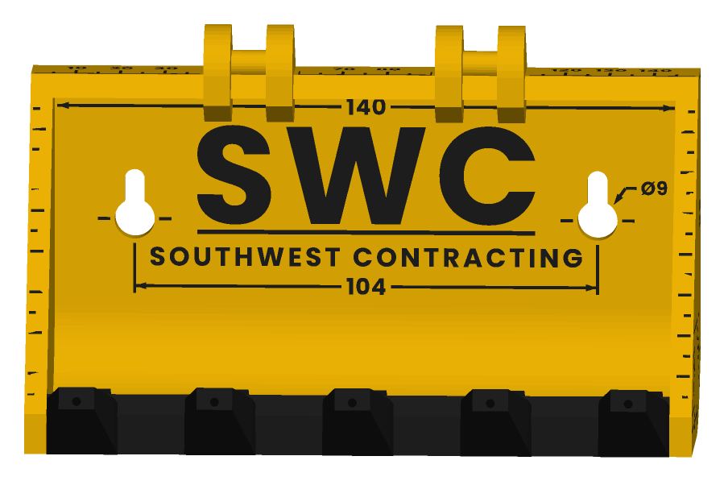
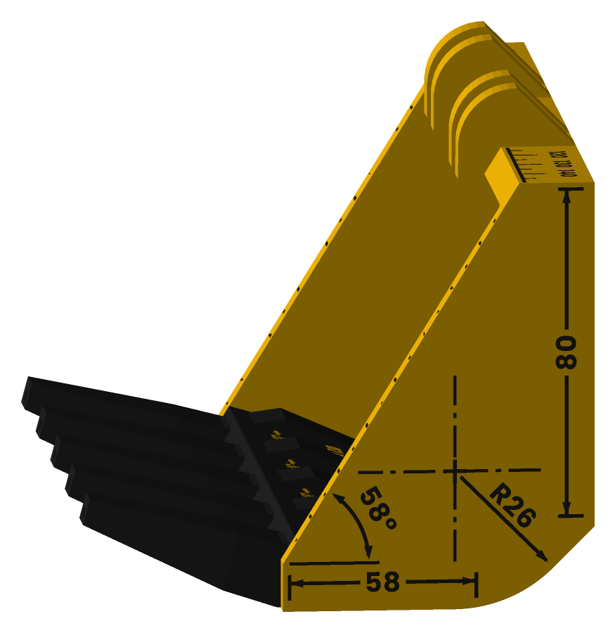
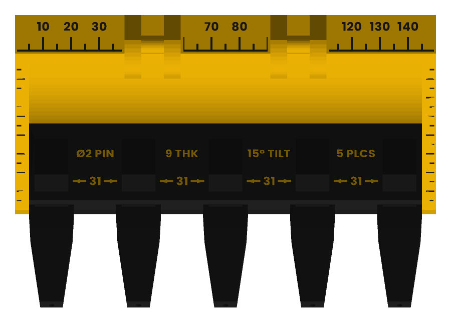
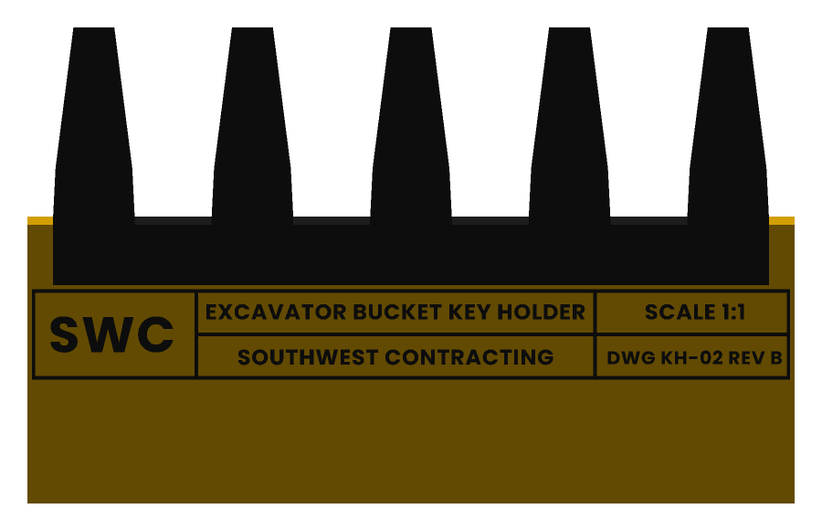

# Excavator bucket key holder: SWC edition

`bucket.3mf` is a two-colour print, yellow and black, that opens with each part
on its own filament in Bambu Studio, Orca and PrusaSlicer. `make_bucket.py`
rebuilds it: `python3 keyholders/make_bucket.py`.

This is v2 of the bucket from the Weave-Trial repo (`keyholders/`), whose
teeth snapped off at the root.

## Why the teeth snapped, and what changed

In v1 each black tooth was cut flush against the yellow bucket. All that held
a tooth on was a ~13 x 6 mm face where the two filaments met, lying flat in a
single layer, right where a hanging key bends the tooth hardest.

| | v1 | v2 |
|---|---|---|
| Tooth root | butt joint to yellow, one layer | continuous black, grown out of a full-width black cutting-edge plate |
| Black/yellow seam | 5 x ~78 mm², flat in a layer | lap joint plus side plates, ~3,000 mm², mostly upright walls that bond within each layer |
| Root section | ~13 x 6 mm | ~16 x 11.5 mm with an adapter strap over the lip, ~4x the bending strength |
| Cutting edge | 7 mm | 9 mm |
| Reinforcement | none | 2 mm pin channel down each tooth |

**Pin channels.** Each tooth has a 2 mm hole from its blunt tip, 54 mm back
into the plate. After printing, push in a 2 mm nail, or a length of 1.75 mm
filament with a drop of CA glue, and snip it flush. Even left empty, the hole
gets its own walls from the slicer, which stiffens the tooth.

## Slicer settings

- 4–5 walls and 25–40% gyroid infill. The walls do most of the work.
- Print on its back, as the file is laid out. No supports.
- PETG is tougher than PLA for the teeth. In PLA, a slightly hotter nozzle
  and less part cooling on the teeth improve layer bonding.

## Artwork: a drawing of itself

Every flat face carries part of an engineering drawing of the bucket, and
every number on it is a real dimension:

| Where | What (black on yellow unless noted) |
|---|---|
| Back wall | **SWC** monogram and SOUTHWEST CONTRACTING, 140 inside width, 104 keyhole spacing with centre marks, Ø9 callout |
| Side plates | side elevation: 80 high, 58 deep, R26 heel with centre lines, 58° mouth angle |
| Top | a ruler across the full 150 mm width |
| Side plates' front edges | ticks every 5 mm |
| Cutting-edge plate | **yellow on black**: 31 tooth pitch, Ø2 PIN, 9 THK, 15° TILT, 5 PLCS |
| Underneath | title block: SWC, EXCAVATOR BUCKET KEY HOLDER, SCALE 1:1, DWG KH-02 REV B |

 
 

All the artwork is inlaid flush with the surface, not raised. It goes 0.6 mm
deep on faces that lie flat or slope up in the print, and 0.8 mm on faces
that stand upright. The keyholes are 104 mm apart. The upright faces (the
side plates, top, underneath and edge plate) change colour on many layers.
That's free on a tool changer, but costs purge on an AMS. `drafting.py` holds
the dimension, arrow, leader and centre-line helpers.

## Layer height

0.2 mm is the right choice for this part. It is not much stronger or weaker
than the alternatives: for a 0.4 mm nozzle, anywhere from about 0.16 to 0.28
mm gives similar layer bonding. Walls, nozzle temperature and cooling matter
far more. At 0.2 mm the 0.6 mm inlays are exactly 3 layers.
