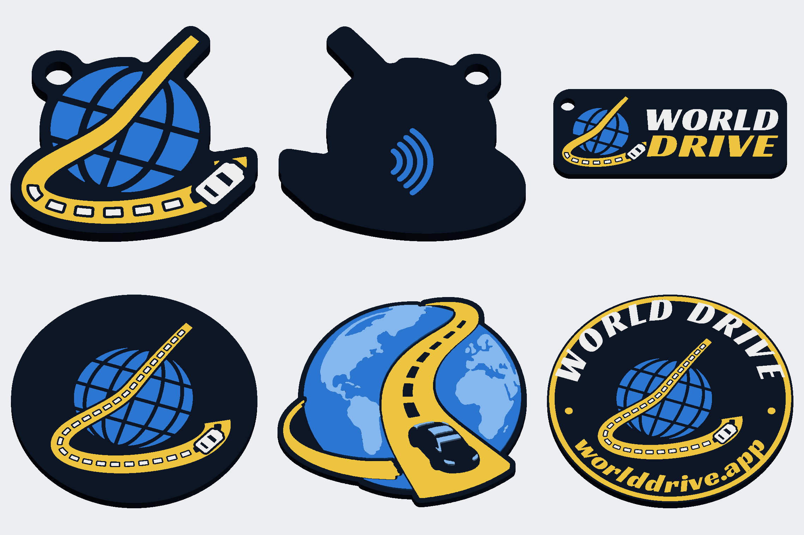
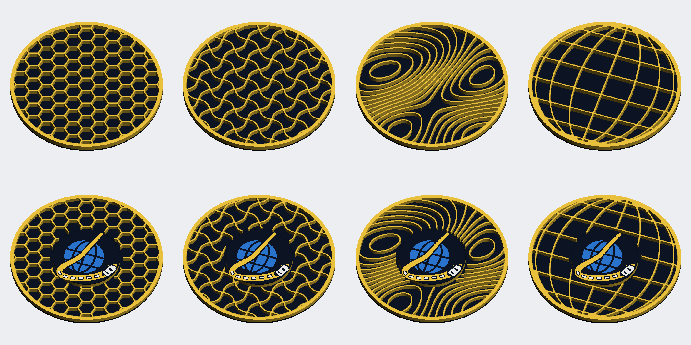

# World Drive keychains & coasters

`python3 worlddrive/designs.py` rebuilds everything (about 20 s): the flat
artwork in `art/`, the printable files in `stl/` (a 3MF with the colours
already assigned, and a single-colour STL), and the renders in `previews/`.
The parts are made by `src/logocard.py`, the same code as the NFC logo cards.

| File | What | Size |
|---|---|---|
| `wd_mark_keychain` | The globe-and-road mark, die-cut, with a ring tab | 45 × 45 × 3 mm |
| `wd_mark_keychain_nfc` | The same, 50 mm, two halves with a 25 mm NTAG sticker glued between them. Write `https://worlddrive.app` to the tag and a tap opens the game. Tap arcs on the back | 50 × 49 × 3 mm |
| `wd_wordmark_keychain` | The mark plus WORLD / DRIVE on a rounded tag, ring hole on the left | 80 × 35 × 3 mm |
| `wd_coaster_mark` | The mark on a plain navy disc | Ø100 × 4 mm |
| `wd_logo_keychain` | The site's current mark as a keychain in relief: the ocean lowest, the continents a step above it, the road lifted off the world, its lane dashes standing up out of it, and the car above them, with its windows set into its top ([side view](previews/wd_logo_keychain_side.png)). Steps 0.4 / 0.8 / 1.2 / 1.5 / 1.8 mm over a 3 mm body (`RELIEF` in `designs.py`). Ring tab top left. Print it **back down** | 55 × 54 × 4.8 mm |
| `wd_coaster_logo` | The site's current mark as the coaster: the globe with its continents, the road down the front of it with the car, and the orbit ring, die-cut to that shape. The globe stands 1.2 mm above the road and keylines, so the mug sits on it ([side view](previews/wd_coaster_logo_side.png)). Print it **back down** (as exported), not face down: the raised globe is the top | 110 × 107 × 4.8 mm |
| `wd_coaster_badge` | WORLD DRIVE over the top, worlddrive.app underneath, yellow rim | Ø100 × 4 mm |

## Colours: four filaments, one AMS

| Slot | Colour | Used for |
|---|---|---|
| Body | navy `#0b1424` (or black) | the card itself and the keylines |
| | blue `#2b7de0` | the globe |
| | light blue `#8cc4ff` | the logo coaster's continents (in place of white) |
| | yellow `#ffd23f` | the road, DRIVE, the coaster rim and URL |
| | white | the car, the lane dashes, WORLD |

The colours are flush inlays in the face, so the filament only changes in the
last few layers. They print **artwork face down** on the bed, so a textured
PEI plate gives the faces that texture. No supports.

The mark is a simplified flat-colour redraw of the site's icon so it prints
cleanly. It comes in two levels of detail (`DETAIL` in `designs.py`):

- **full**: three meridians, three parallels and fine lane dashes. Used only
  where the mark is 58 mm or more across, which means the three solid coasters.
- **bold**: fewer and fatter grid lines, wider gaps between colours, bigger
  dashes only where the road is wide, and a bigger car. Used on the keychains
  and the infill coasters' centre disc, where the mark is 30–45 mm across.

At those sizes no part of the bold mark is under 0.4 mm and only 1–2 % of any
colour is under 0.8 mm (two passes of a 0.4 mm nozzle). The full mark at
45 mm had 36 % of the white under 0.8 mm and 9 % of the gaps between colours
under 0.4 mm.

Coasters: put four 10 mm felt or cork dots on the back, or glue a 95 mm cork
disc on it. PETG copes with hot mugs better than PLA does.

To change something, edit `designs.py`: `mark()` is the logo, `DESIGNS` sets
each item's size, ring, NFC, backing and thickness, and the four colours are
at the top.

## The logo coaster's artwork

`wd_coaster_logo` isn't drawn here like the others: it's traced from the site's
own logo, `art/mark_source.png` (Neptune-digital-twin's
`exports/worlddrive-mark-transparent.png`), by `trace_mark.py`, which writes
`art/mark_logo.svg` for `designs.py`, and the same pieces kept apart and made printable at
keychain size in `art/mark_logo_keychain.json`, for the relief keychain (`relief_keychain()`
in `designs.py`: logocard's inlays for the ocean, continents and road, and the car as a navy
block of the body standing up off the face). The logo's five colours go to the four
filaments: navy for the outlines, lane dashes and car; blue for the ocean;
yellow for the road and orbit ring; light blue (`#8cc4ff`) for the continents
and the car's windows and headlights. Nothing on it is under 0.6 mm wide. If
the logo changes, replace `mark_source.png` and run
`pip install opencv-python-headless` then `python3 worlddrive/trace_mark.py`,
then `designs.py`. The keychains and the two disc coasters still use the
older mark drawn in `mark()`.

## Every coaster in one file

`stl/wd_all_coasters.3mf` has the ten four-colour coasters (the eight infill
ones, the badge and the mark) laid out four across, each its own object, every
colour a part already on its extruder, the same four for all of them: 1 navy,
2 yellow, 3 blue, 4 white. It's bigger than one plate: the slicer puts them on
as many as it needs. The logo coaster isn't in it (its light blue would be a
fifth filament); it prints from its own file. `python3
worlddrive/combine_coasters.py` makes it again after any of them is rebuilt.
([preview](previews/all_coasters.png))

Every 3MF here is written in Bambu Studio's own form (`bambu3mf.py`): one object
per piece, one part per colour, each part's extruder in
`Metadata/model_settings.config`. That's the form Snapmaker's slicer, Orca and
Bambu Studio take colours from; they read a plain 3MF's colours, or
PrusaSlicer's, as all filament 1. Every file uses the same extruders, so the
spools go in once: **1 navy, 2 yellow, 3 blue, 4 white** (the logo coaster and
logo keychain put their light blue on 4 instead of white).

# Infill coaster set

`python3 worlddrive/infill_coasters.py` builds these. They're the open-top
"infill" coasters: a solid floor, a rim, and thin walls standing on the floor
with nothing over them. The pattern is modelled as real walls instead of
relying on a slicer setting, so they print the same with default settings in
any slicer.

| Pattern | Look |
|---|---|
| `honeycomb` | hexagons, 10 mm across |
| `gyroid` | a slice through a gyroid, like the slicer infill |
| `topo` | contour lines of a made-up landscape: two hills, a valley and a saddle. The contour step is set from the steepest slope so no two lines are closer than 2.4 mm |
| `globe` | a globe's meridians and parallels, tilted like the logo |

Each one comes plain (`wd_infill_<pattern>`) or with the bold World Drive
mark on a solid 44 mm disc in the middle (`wd_infill_<pattern>_logo`).
`wd_infill_set.3mf` and `wd_infill_set_logo.3mf` have all four laid out 2 × 2
on one plate (206 × 206 mm).

- Ø100 mm, 4.8 mm tall: a 1.2 mm floor with walls 3.6 mm high on it.
- The walls are 0.9 mm, two lines of a 0.4 mm nozzle. Anywhere two walls
  would be closer than 1.2 mm (a slot that prints as a smear rather than a
  gap) they are merged into one band (`MIN_GAP`). The biggest open
  pocket is about 16 mm across, so any mug sits on plenty of walls.
- **Colours**: the floor is one filament and the walls another, so the
  plain ones need just one filament change, at 1.2 mm. On a single-nozzle
  printer a pause (M600) at that height does it. The logo ones also use
  blue and white in the top 0.6 mm of the centre disc.
- Good colour pairs: navy floor with yellow walls (as rendered), black with
  silk gold, white with any bright colour, or a translucent floor with an
  opaque pattern.
- **Slicer**: leave the defaults. If your slicer adds "only one wall on top
  surfaces" or ironing, it won't matter, since the walls have no top surface
  wider than 0.9 mm.
- PETG copes with hot mugs better than PLA does.

Edit the numbers at the top of `infill_coasters.py` (`D`, `BASE`, `HEIGHT`,
`WALL`, `RIM`) to change the size. A new pattern is a function returning
shapely lines, plus one line in `PATTERNS`.
